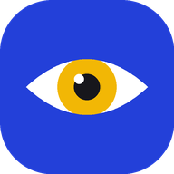
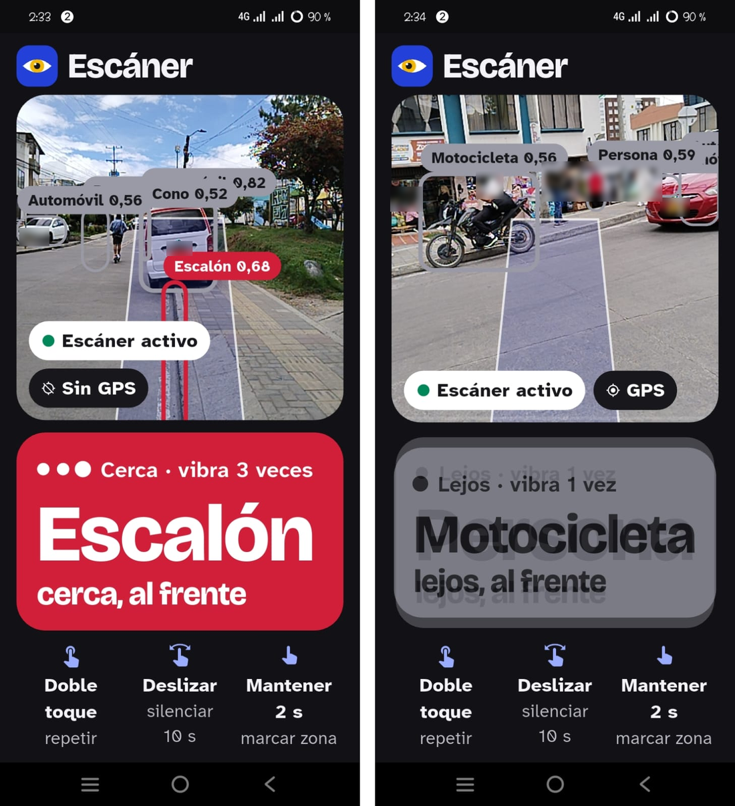
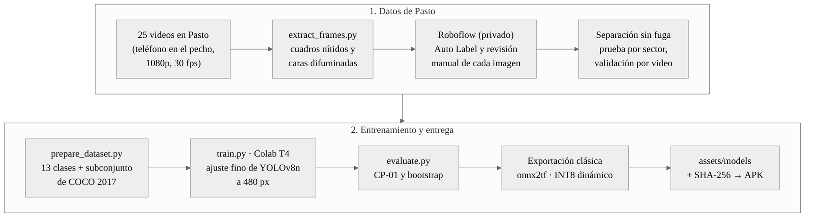
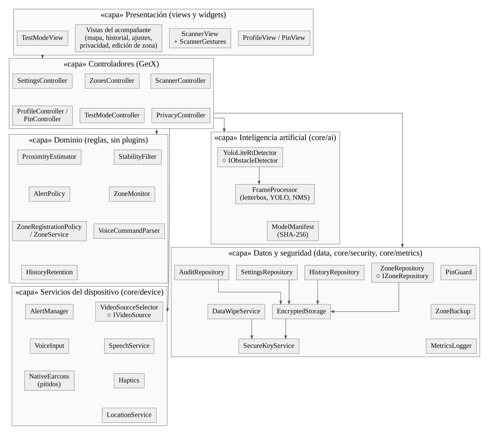
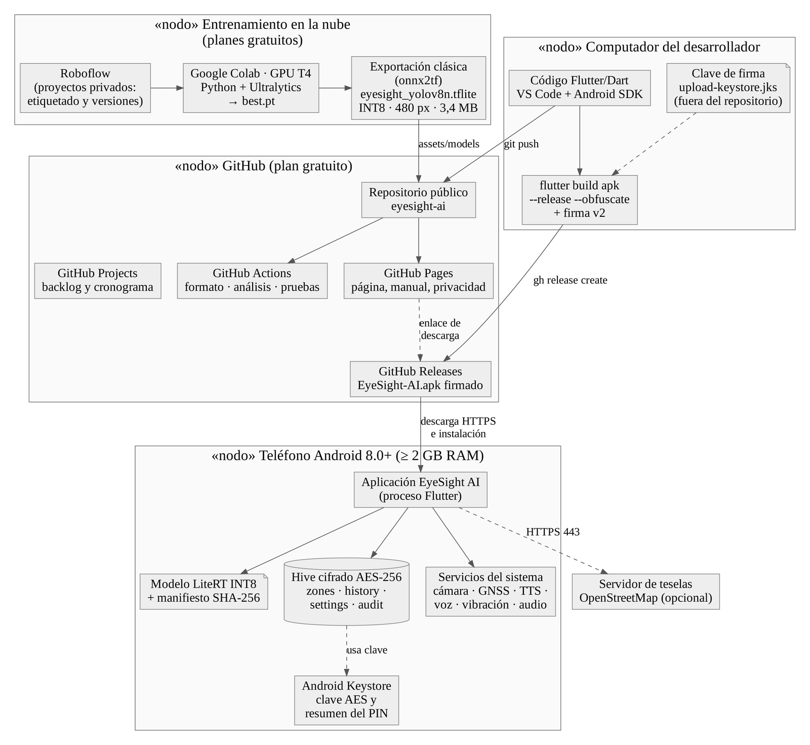

<p align="center">
  
</p>

<h1 align="center">EyeSight AI</h1>

<p align="center">
  <strong>Avisos de obstáculos por voz, vibración y pitidos para personas con discapacidad visual.</strong><br>
  Visión artificial en el teléfono · Funciona sin internet · Memoria cifrada de zonas de riesgo · Hecho en Pasto, Nariño
</p>

<p align="center">
  <a href="https://github.com/dramirezdlp99/eyesight-ai/actions/workflows/ci.yml"></a>
  <a href="https://github.com/dramirezdlp99/eyesight-ai/releases/latest"></a>
  
  
  
  <a href="LICENSE"></a>
</p>

<p align="center">
  <a href="https://github.com/dramirezdlp99/eyesight-ai/releases/latest/download/EyeSight-AI.apk"><strong>Descargar el APK</strong></a> ·
  <a href="https://dramirezdlp99.github.io/eyesight-ai/">Página del proyecto</a> ·
  <a href="https://dramirezdlp99.github.io/eyesight-ai/manual.html">Manual de usuario</a> ·
  <a href="https://github.com/users/dramirezdlp99/projects/2">Tablero del proyecto</a>
</p>

> [!IMPORTANT]
> EyeSight AI **complementa** el bastón blanco y el perro guía; no los reemplaza. Es un prototipo
> académico en fase de pruebas.

---

## Contenido

- [Qué es](#qué-es)
- [Qué hace](#qué-hace)
- [Cómo funciona](#cómo-funciona)
- [El modelo de Pasto](#el-modelo-de-pasto)
- [Resultados](#resultados)
- [Privacidad y seguridad](#privacidad-y-seguridad)
- [Arquitectura](#arquitectura)
- [Instalación](#instalación)
- [Desarrollo](#desarrollo)
- [Entrenar el modelo](#entrenar-el-modelo)
- [Despliegue sin servidores](#despliegue-sin-servidores)
- [Documentación](#documentación)
- [Estado y limitaciones](#estado-y-limitaciones)
- [Licencia y autoría](#licencia-y-autoría)

## Qué es

EyeSight AI es una aplicación Android que usa la cámara del teléfono, a la altura del pecho, para
reconocer los obstáculos del camino y avisarlos con voz, vibración y pitidos suaves. También
recuerda los lugares peligrosos de los recorridos habituales y avisa antes de llegar a ellos.

Todo ocurre **dentro del teléfono**: no hay cuentas, servidores ni nube, y la ubicación del usuario
nunca sale de su dispositivo.

Es el trabajo de grado de Ingeniería de Software de **David Fernando Ramírez de la Parra**,
Universidad Cooperativa de Colombia, sede Pasto, dirigido por el **PhD Cristian Camilo Ordoñez
Quintero**.

## Qué hace

| | |
|---|---|
| **Detecta 13 tipos de obstáculos** | Postes, escalones y bordillos, bolardos, conos, obras, huecos, personas, perros, bicicletas, carros, motos, buses y camiones |
| **Dice qué, qué tan cerca y dónde** | «Poste, cerca, al frente» · «Persona, a media distancia, a la izquierda» |
| **Avisa con tres canales** | Voz en español, vibración y pitidos con el mismo código: 3 cerca, 2 a media distancia, 1 lejos |
| **Recuerda zonas de riesgo** | Guarda solo los obstáculos fijos peligrosos, o los que marca el usuario, y avisa a 20 m: «Atención: hueco a 15 metros» |
| **Funciona sin internet** | Detección, voz, pitidos, zonas, historial y ajustes, en modo avión |
| **Tres perfiles** | Ceguera total (voz y gestos), baja visión (alto contraste) y acompañante (con PIN) |
| **Control por voz y gestos** | «repetir», «silencio», «marcar zona», «terminar»; doble toque, deslizar y mantener presionado |
| **Para el acompañante** | Mapa de zonas (OpenStreetMap), historial con gráficas, ajustes, copia cifrada de zonas y borrado total |
| **Modo de pruebas** | Mide inferencia, cuadros por segundo y tiempo hasta la alerta, y exporta CSV |

<p align="center">
  <br>
  <sub>Prueba de campo en Pasto con la versión 1.1.0. Placas y rostros difuminados.</sub>
</p>

## Cómo funciona

1. La cámara entrega unos 4 cuadros por segundo.
2. Un hilo aislado ajusta cada cuadro a 480 × 480 píxeles y ejecuta **YOLOv8n** con **LiteRT**.
3. Las detecciones pasan por la supresión de no máximos y un filtro que las confirma en **3 cuadros
   seguidos**, para evitar falsas alarmas.
4. La cercanía (cerca, media, lejos) y la dirección salen de la posición y el tamaño de la caja.
   Solo se avisa lo que está en la franja de paso o muy cerca.
5. En paralelo, cada 3 segundos el GPS se compara con las zonas de riesgo guardadas.

> **¿Por qué cercanía y no metros?** Una sola cámara no mide profundidad, y calcular metros por
> geometría depende de la inclinación del teléfono, que cambia al caminar. Un número falso es más
> peligroso que una categoría honesta.

## El modelo de Pasto

El YOLOv8n preentrenado en COCO no conoce postes, bolardos, escalones ni huecos. Por eso se
construyó un conjunto de datos propio:

<p align="center">
  
</p>

- **25 videos** grabados con el teléfono en el pecho, en el barrio y en sectores cercanos a la universidad.
- **Privacidad:** rostros difuminados automáticamente y revisión manual de cada imagen.
- **Etiquetado en Roboflow** con Auto Label y **revisión y corrección de cada imagen**.
- **Sin fuga de información:** la prueba son 8 videos de sectores que el modelo nunca vio, y la
  validación se separa por video completo.
- **Contra el olvido catastrófico:** un subconjunto de COCO 2017 con personas, vehículos y perros.
- **Entrenamiento** en Google Colab (GPU T4) con ajuste fino a 480 px.
- **Exportación** INT8 de rango dinámico con onnx2tf: 3,4 MB, compatible con procesadores ARM.

| Conjunto | Imágenes | Cajas |
|---|---|---|
| Entrenamiento (Pasto) | 462 (1242 con aumentos) | 2718 |
| Prueba (sectores nuevos de Pasto) | 106 | 580 |

Se hicieron cuatro experimentos; cada uno corrigió un problema medido en el anterior. El detalle está
en [`docs/resultados-modelo.md`](docs/resultados-modelo.md).

## Resultados

**Modelo (prueba de Pasto, AP@0,5, modelo INT8 de la aplicación):**

| Clase | AP@0,5 | Nota |
|---|---|---|
| Persona | 0,636 | El preentrenado: 0,684 |
| Automóvil | 0,585 | Supera al preentrenado (0,576) |
| Motocicleta | 0,531 | Supera al preentrenado (0,419) |
| Poste | 0,309 | Clase nueva: el preentrenado no la detecta |
| Escalón | 0,302 | Clase nueva; cuando lo anuncia, acierta el 95 % de las veces |

En las clases comunes el ajuste no supera al modelo preentrenado (diferencia de mAP@0,5 de −0,057,
IC 95 % [−0,161; −0,007]); su aporte son las clases nuevas del andén.

**En el teléfono** (vivo Y22s, gama baja):

| Métrica | Meta | Resultado |
|---|---|---|
| Captura hasta la alerta | ≤ 500 ms | **259 ms** (mediana); máximo 319 ms ✅ |
| Inferencia por cuadro | < 100 ms | 235 ms (mediana) |
| Cuadros por segundo | 5 a 10 | 3,7 |
| Funciones críticas sin internet | 100 % | **100 %** ✅ |

Detalle en [`docs/resultados-pruebas.md`](docs/resultados-pruebas.md).

## Privacidad y seguridad

| Control | Cómo |
|---|---|
| Datos cifrados | Hive con **AES-256**; clave de 256 bits en el almacenamiento respaldado por el **Android Keystore** |
| PIN del acompañante | **PBKDF2-HMAC-SHA256** con sal y 120 000 iteraciones; bloqueo de 60 s tras 5 intentos |
| Copia de zonas | Texto cifrado con AES-256-CBC + HMAC-SHA256, para compartir por WhatsApp o correo |
| Integridad del modelo | El **SHA-256** del modelo se verifica antes de cargarlo |
| Borrado total | Escribiendo «ELIMINAR» se borran zonas, historial, ajustes, PIN y clave |
| Auditoría | Cada creación, edición y eliminación de zonas queda registrada |
| Plataforma | Sin copia de seguridad automática, sin HTTP, permisos mínimos, código ofuscado y APK firmado |
| Repositorio | Sin claves de API, sin `.env`, sin servidores; `*.jks` y `key.properties` en `.gitignore` |

El modelo de amenazas (STRIDE) y la política de privacidad (Ley 1581 de 2012) están en
[`docs/`](docs).

## Arquitectura

Monolito modular que se ejecuta por completo en el teléfono, organizado por capas:

```
lib/
  core/          IA (LiteRT, letterbox, YOLO, NMS), dispositivo (cámara, GPS, voz, vibración, pitidos),
                 seguridad, métricas y configuración
  domain/        entidades, interfaces de repositorios y reglas (cercanía, estabilidad, alertas, zonas)
  data/          repositorios Hive cifrados: zonas, historial, ajustes y auditoría
  presentation/  vistas, widgets, controladores GetX, inyección de dependencias, rutas y tema
test/            377 pruebas de Flutter
ml/              datos, entrenamiento, evaluación y exportación del modelo (Python) + 46 pruebas
docs/            decisiones, resultados, manual, privacidad, validación y publicación
website/         página web publicada en GitHub Pages
```

<p align="center">
  
</p>

**Tecnologías:** Flutter y Dart 3 · GetX · tflite_flutter (LiteRT) · Hive · flutter_secure_storage ·
camera · geolocator · flutter_tts · speech_to_text · flutter_map + OpenStreetMap · Python ·
Ultralytics YOLOv8 · Roboflow · Google Colab · onnx2tf · GitHub Actions.

**Diseño «Barniz de Pasto»:** identidad propia inspirada en el barniz de Pasto (mopa-mopa) y las
grecas de Nariño. Cobalto `#2340D9`, carmín `#D11F3A` (peligro cercano), oro `#F2B705` (atención),
esmeralda `#00875A` (acompañante). Tipografías Atkinson Hyperlegible Next y Bricolage Grotesque,
contraste mínimo de 4,5:1 verificado por pruebas, botones de 56 dp o más y compatibilidad con TalkBack.

## Instalación

1. Desde el teléfono, abra la [página del proyecto](https://dramirezdlp99.github.io/eyesight-ai/) y
   toque **Descargar para Android**.
2. Abra `EyeSight-AI.apk`; si Android lo pide, permita instalar aplicaciones de ese origen.
3. Acepte cámara, micrófono y ubicación. La app anuncia los perfiles por voz.

Para los comandos de voz sin internet, instale el paquete de **español sin conexión** en los ajustes
de reconocimiento de voz de Android.

## Desarrollo

Requisitos: Flutter estable (Dart 3.6 o superior) y Android SDK.

```powershell
flutter pub get
dart format lib test
flutter analyze
flutter test
```

Con un teléfono conectado por USB (depuración USB activada):

```powershell
flutter devices
flutter run
```

Compilación de producción (la firma usa `android/key.properties`, que nunca se sube al repositorio):

```powershell
flutter build apk --release --obfuscate --split-debug-info=build\symbols
```

La integración continua ([`ci.yml`](.github/workflows/ci.yml)) repite en cada *push* el formato, el
análisis estático y las pruebas de Flutter y de Python.

## Entrenar el modelo

El módulo [`ml/`](ml) contiene todo el proceso:

| Paso | Archivo |
|---|---|
| Guía de grabación | [`ml/GUIA-GRABACION.md`](ml/GUIA-GRABACION.md) |
| Extraer cuadros nítidos y difuminar rostros | `ml/scripts/extract_frames.py` |
| Subconjunto de COCO | `ml/scripts/fetch_coco_subset.py` |
| Unir y preparar el conjunto | `ml/scripts/prepare_dataset.py` |
| Entrenar | `ml/scripts/train.py` |
| Evaluar (CP-01 y bootstrap) | `ml/scripts/evaluate.py` |
| Cuaderno de Colab | [`ml/notebooks/EyeSight_entrenamiento.ipynb`](ml/notebooks/EyeSight_entrenamiento.ipynb) |

La clave de Roboflow se guarda solo en los secretos de Colab (`ROBOFLOW_API_KEY`). La exportación
compatible con ARM se hace por la ruta clásica (Ultralytics 8.4.82, TensorFlow 2.19.0, onnx2tf
1.27.10); ver [`docs/resultados-modelo.md`](docs/resultados-modelo.md).

## Despliegue sin servidores

<p align="center">
  
</p>

| Pieza | Dónde | Costo |
|---|---|---|
| Código, tablero e integración continua | GitHub, GitHub Projects y GitHub Actions | Gratis |
| Instalador APK firmado | [GitHub Releases](https://github.com/dramirezdlp99/eyesight-ai/releases) | Gratis |
| Página, manual y privacidad | [GitHub Pages](https://dramirezdlp99.github.io/eyesight-ai/) | Gratis |
| Base de datos | Hive cifrado **en cada teléfono** | Gratis |
| Entrenamiento | Roboflow y Google Colab (planes gratuitos) | Gratis |

No hay alojamiento web, servidor de aplicación ni base de datos en la nube porque no hay nada que
centralizar: los datos de cada persona se quedan, cifrados, en su teléfono.

| Versión | Fecha | Novedad |
|---|---|---|
| 1.0.0 | 21 oct. 2026 | Prototipo completo con el modelo de COCO |
| 1.0.1 | 21 oct. 2026 | Prueba y diagnóstico de vibración |
| 1.0.2 | 21 oct. 2026 | Pitidos suaves (algunos teléfonos bloquean la vibración con la cámara activa) |
| 1.1.0 | 9 nov. 2026 | Modelo ajustado a Pasto, compatible con ARM |

## Documentación

| Documento | Contenido |
|---|---|
| [`docs/decisiones-de-diseno.md`](docs/decisiones-de-diseno.md) | 13 decisiones de arquitectura (ADR) |
| [`docs/resultados-modelo.md`](docs/resultados-modelo.md) | Experimentos 1 a 4 y exportación al teléfono |
| [`docs/resultados-pruebas.md`](docs/resultados-pruebas.md) | Rendimiento, modo avión y prueba de campo |
| [`docs/manual-de-usuario.md`](docs/manual-de-usuario.md) | Manual para usuarios y acompañantes |
| [`docs/politica-de-privacidad.md`](docs/politica-de-privacidad.md) | Política de privacidad (Ley 1581 de 2012) |
| [`docs/kit-validacion.md`](docs/kit-validacion.md) | Guion, tareas y cuestionario SUS para validar con usuarios |
| [`docs/publicacion.md`](docs/publicacion.md) | Firma, Releases, Pages y Google Play |

La gestión del proyecto (backlog, 7 sprints, cronograma y evidencias de pruebas) está en
[GitHub Projects](https://github.com/users/dramirezdlp99/projects/2).

## Estado y limitaciones

- ✅ Las 15 historias de usuario están implementadas y verificadas por 423 pruebas automatizadas.
- ⚠️ En un teléfono de gama baja el modelo analiza unos 3,7 cuadros por segundo (meta: 5 a 10).
- ⚠️ El recall del modelo es bajo en clases difíciles como los huecos; por eso las zonas de riesgo
  avisan por GPS los peligros conocidos.
- ⏳ **Pendiente:** la validación con usuarios de la Fundación Nueva Luz, la medición de la cercanía
  y el recorrido sistemático sobre zonas registradas.
- 🔜 **Trabajo futuro:** más datos por clase, cámara USB en gafas, publicación en Google Play y
  estimación de profundidad.

## Licencia y autoría

Software libre bajo la licencia [GNU AGPL-3.0](LICENSE), heredada de Ultralytics YOLOv8. Las
tipografías tienen licencia OFL y los datos del mapa son © colaboradores de OpenStreetMap. La
identidad visual, el ícono y el diseño «Barniz de Pasto» son propios.

**Autor:** David Fernando Ramírez de la Parra · **Director:** PhD Cristian Camilo Ordoñez Quintero ·
Universidad Cooperativa de Colombia, sede Pasto, 2026.
